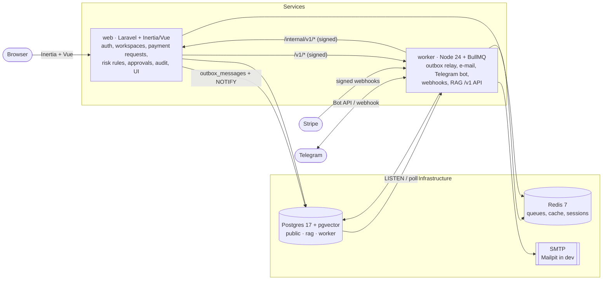

# ScamPause Business

**Stop. Call. Confirm. — before every payment that looks different.** ScamPause Business is the pause button a
small business presses before money leaves the account. An owner or bookkeeper forwards a payment request
(PDF, photo, `.eml`) or types it in; ScamPause extracts the amount, payee, bank details and due date, compares
them with the vendor's history, checks the sender and domain, detects urgency and pressure, routes the payment
to a second approver, asks for confirmation in Telegram and keeps tamper-evident proof of who verified the
request, how and when. It never claims a payment is safe: it shows risk signals and enforces independent
verification through a number you already know.

Product scope and roadmap: [`docs/PLAN.md`](docs/PLAN.md). Build specification: [`docs/DOMAIN_CONTRACT.md`](docs/DOMAIN_CONTRACT.md).
Architecture: [`docs/ARCHITECTURE.md`](docs/ARCHITECTURE.md). Shared platform rules: [`PLATFORM.md`](PLATFORM.md).

> Русская версия — ниже, в разделе [«Русский»](#русский).

---

## Contents

- [Features](#features)
- [Stack](#stack)
- [Architecture](#architecture)
- [Prerequisites](#prerequisites)
- [Quick start](#quick-start)
- [Ports](#ports)
- [Everyday commands](#everyday-commands)
- [Configuration](#configuration)
- [Testing](#testing)
- [Deployment](#deployment)
- [Troubleshooting on Windows](#troubleshooting-on-windows)
- [Project structure](#project-structure)
- [License](#license)

## Features

- Payment request intake from uploads, e-mails and manual entry with automatic extraction of amount, payee,
  bank details and due date.
- Explainable risk signals: changed bank details, look-alike sender domains, urgency and pressure, unusual
  amounts, compared with the vendor master and payment history.
- Verification by callback to a number already on file, four-eyes approval routing, reminders, escalation and
  expiry, approvals from the app or from Telegram.
- Tamper-evident evidence ledger and audit packets for every decision.
- Knowledge base with a cited assistant (in the app and in the Telegram bot) that answers from the company's
  own payment policies and refuses when the documents do not cover the question.
- Workspaces, roles, invitations, two-factor authentication, audit log, subscriptions (fake gateway offline,
  Stripe when keys are present), privacy tooling (export, deletion, retention).
- Russian and English everywhere, light and dark themes, no third-party requests at runtime.

## Stack

| Part | Technology |
|---|---|
| `apps/web` | Laravel 13, Inertia 2, Vue 3 + TypeScript, Tailwind 4, shadcn-vue, Pest, Vitest |
| `apps/worker` | Node 24 + TypeScript, BullMQ on Redis 7, Fastify, grammY Telegram bot, TypeScript RAG (`/v1` API), Vitest |
| Data | Postgres 17 + pgvector (schemas `public`, `rag`, `worker`), Redis 7 |
| `e2e` | Playwright + axe-core |

## Architecture

Two services share one Postgres database (each migrates only its own schemas) and talk to each other over
HMAC-signed HTTP (`X-Signature: t=…,v1=…`, shared `INTERNAL_API_SECRET`). The web app never sends e-mail or
Telegram messages and never calls an LLM itself: it writes to a transactional **outbox** that the worker relays
to BullMQ queues. The worker also serves the RAG API (`/v1/chat`, `/v1/documents/*`, `/v1/admin/ai/*`) that the
web app reaches through `AI_URL`.



Everything runs **offline** with fake and mock drivers: no Stripe, Telegram or LLM keys are needed.

## Prerequisites

| Tool | Version | Notes |
|---|---|---|
| Docker Desktop | 25+ (compose v2) | Postgres + pgvector, Redis 7, Mailpit |
| PHP | 8.4 | extensions: `pdo_pgsql`, `pgsql`, `mbstring`, `openssl`, `curl`, `zip`, `gd`, `fileinfo`; `redis` and `intl` recommended |
| Composer | 2.x | |
| Node.js | 24 LTS (npm 11) | |
| Tesseract | 5.x with `rus` + `eng` | OCR of scanned payment requests in the worker |

`npm run doctor` checks all of the above, the ports and the env files, and prints a fix for every problem.

## Quick start

```bash
npm run setup     # docker infra → env files + shared secrets → composer/npm installs
                  # → migrations + demo seed → web assets + worker build → Playwright
npm run dev       # web :8300 + vite :5175 + worker :8301 (one terminal, prefixed logs)
```

Open <http://localhost:8300> and sign in as the demo workspace owner **`demo@scampause-business.test` / `password`**
(platform admin: **`admin@scampause-business.test` / `password`**). Mail lands in Mailpit at <http://localhost:8331>.

`npm run setup` runs `scripts/setup.ps1` on Windows and `scripts/setup.sh` elsewhere. It is idempotent:
`npm ci` only runs for packages whose `package.json` or lockfile changed, migrations only apply what is new and
secrets are never rotated. Options: `-- --fresh` (drop all data and re-seed), `-- --reinstall`, `-- --skip-docker`,
`-- --skip-build`, `-- --skip-e2e`. Stop everything with `npm run stop` (`-- --keep-infra` leaves docker running).

## Ports

| Service | Port | URL |
|---|---|---|
| web (Laravel) | 8300 | <http://localhost:8300> (health: `/up`) |
| vite dev server | 5175 | used by `npm run dev` only |
| worker (Fastify) | 8301 | `/healthz`, `/metrics`, Bull Board `/admin/queues`, RAG `/v1/*` |
| Postgres (pgvector) | 5443 | db `scampause` (+ `scampause_test`, `scampause_e2e`), user/password `app` / `app` |
| Redis 7 | 6393 | |
| Mailpit SMTP / UI | 1033 / 8331 | <http://localhost:8331> |

The machine's native Postgres (5432) and Redis (6379) are never used; `npm run doctor` flags any env file that
points at them.

## Everyday commands

| Command | What it does |
|---|---|
| `npm run setup` | full, idempotent developer setup |
| `npm run dev` | all dev servers; `-- --only web,vite` for a subset, `-- --scheduler` adds `schedule:work` |
| `npm run stop` | stops whatever listens on the dev ports, then `docker compose stop` |
| `npm run test` | Pest + Vitest (web and worker) + root script tests |
| `npm run e2e` | Playwright suite |
| `npm run lint` / `npm run lint:fix` | pint, `vp check`, vue-tsc, phpstan · eslint + tsc · e2e + scripts tsc |
| `npm run build` | web assets + worker bundle |
| `npm run doctor` | toolchain, ports, infra and env diagnostics |
| `npm run env:sync` | create missing `.env` files, generate secrets once, keep shared secrets identical |
| `npm run infra:up` / `infra:down` / `infra:logs` | docker compose helpers |

## Configuration

Each app lists its variables in its own `.env.example` ([`apps/web`](apps/web/.env.example),
[`apps/worker`](apps/worker/.env.example)). `scripts/env-sync.ts` creates the `.env` files and owns the secrets:

| Variable | Apps | Managed by env-sync |
|---|---|---|
| `INTERNAL_API_SECRET` | web, worker | generated once, identical in both (request signing) |
| `STRIPE_WEBHOOK_SECRET` | web, worker | generated once, identical in both; Stripe's `whsec_…` with real Stripe |
| `APP_KEY` | web | generated (`base64:` AES-256 key) |
| `QUEUE_DASHBOARD_PASSWORD`, `TELEGRAM_WEBHOOK_SECRET` | worker | generated when declared |
| `PRODUCT_NAME`, `PRODUCT_SLUG` | web, worker | filled from `scripts/project.env` when empty |

| Variable | Default | Meaning |
|---|---|---|
| `AI_URL` (web, worker) | `http://127.0.0.1:8301` | RAG API served by the worker |
| `BILLING_DRIVER` (web) | `fake` | `stripe` + `STRIPE_KEY` / `STRIPE_SECRET` / price ids for real billing |
| `TELEGRAM_BOT_TOKEN`, `TELEGRAM_MODE` (worker) | empty, `disabled` | without a token the bot runs offline (`/dev/telegram/update` still works) |
| `DEV_ROUTES` (worker) | `1` in dev | enables `/dev/*`; ignored in production |

Production env files live in `infra/env/` (see [Deployment](#deployment)).

## Testing

| Layer | Command | Notes |
|---|---|---|
| web | `npm run test:web` | Pest on Postgres `scampause_test`; Vitest for the Vue/TS units |
| worker | `npm run test:worker` | real Postgres/Redis suites skip with a reason when infra is down |
| root scripts | `npm run test:scripts` | `node --test` |
| e2e | `npm run e2e` | Playwright + axe |

The e2e suite runs `chromium-{en,ru}-{light,dark}` plus a mobile project. A network guard fails any test that
requests anything outside localhost, axe-core scans the key pages, and screenshots land in `e2e/artifacts/`.
`E2E_MODE=managed` (default in CI) recreates `scampause_e2e`, migrates and seeds it and starts web and worker
with offline drivers; `reuse` runs against a running `npm run dev`; `auto` (local default) picks one of the two.

## Deployment

Multi-stage, non-root Dockerfiles in [`infra/docker/`](infra/docker): `web` (FrankenPHP + PHP 8.4, built Vite
assets, port 8080) and `worker` (Node 24, compiled `dist/`, port 8301).

```bash
npm run env:sync -- --prod   # infra/env/.env.{web,worker,compose}: production settings + fresh secrets
npm run prod:up              # build + start: postgres, redis, migrations, web, scheduler, worker
```

`docker-compose.prod.yml` defines the topology and injects it into the containers; the env files carry app
settings and secrets. Web is published on `127.0.0.1:8080`, the worker (webhooks, Bull Board) on
`127.0.0.1:8081`; put a TLS reverse proxy in front (`/webhooks/*` → worker, everything else → web).
`--profile sandbox` adds Mailpit as SMTP sink.

CI ([`.github/workflows/ci.yml`](.github/workflows/ci.yml)) runs the platform checks, web, worker, e2e and image
builds on every push and pull request.

## Troubleshooting on Windows

- **`vp build` fails with "Cannot find native binding".** `npm run setup` installs the matching
  `@voidzero-dev/vite-plus-win32-x64-msvc` binding; `npm run doctor` reports it when missing.
- **Russian OCR.** A default Tesseract install has only `eng` + `osd`. Put `rus.traineddata` from
  `tesseract-ocr/tessdata_fast` into a user-writable folder together with copies of `eng.traineddata` and
  `osd.traineddata` and set `TESSDATA_PREFIX` to that folder before `npm run dev`.
- **Unstyled pages in `npm run dev`.** Vite must listen on `127.0.0.1` (the root `npm run dev` does). A stale
  `apps/web/public/hot` left by a killed Vite is removed by `npm run stop`.
- **A port is already in use.** `npm run doctor` shows which process owns 8300/5175/8301; `npm run stop` frees them.
- **Signed links.** Keep `APP_URL=http://localhost:8300`; links in e-mails are only valid on that origin.

## Project structure

```
.
├─ apps/
│  ├─ web/            Laravel + Inertia + Vue 3 + TS + Tailwind 4
│  └─ worker/         Node 24 + BullMQ + grammY + Fastify + TypeScript RAG
├─ e2e/               Playwright + axe
├─ infra/
│  ├─ docker/         web and worker Dockerfiles, FrankenPHP config
│  ├─ env/            production env templates
│  └─ postgres/init/  creates <db>_test, <db>_e2e, extensions and the rag/worker schemas
├─ scripts/           setup, tasks (dev/test/lint/stop/doctor), env-sync, project.env
├─ docs/              PLAN.md, DOMAIN_CONTRACT.md, ARCHITECTURE.md, adr/, seed-documents/
├─ design-system/     brand and UI rules
├─ docker-compose.yml        local infra
├─ docker-compose.prod.yml   full stack
└─ .github/workflows/ci.yml
```

## License

Proprietary. All rights reserved.

---

## Русский

**Стоп. Позвони. Подтверди. — перед каждым платежом, который выглядит иначе.** ScamPause Business — это кнопка
паузы, которую малый бизнес нажимает перед отправкой денег. Владелец или бухгалтер пересылает запрос на оплату
(PDF, фото, `.eml`) или вводит его вручную; сервис извлекает сумму, получателя, реквизиты и срок, сверяет их с
историей поставщика, проверяет отправителя и домен, замечает срочность и давление, направляет платёж второму
согласующему, запрашивает подтверждение в Telegram и сохраняет неизменяемое доказательство того, кто, как и
когда проверил запрос. Сервис никогда не утверждает, что платёж безопасен: он показывает сигналы риска и требует
независимой проверки по номеру, который у вас уже есть.

### Возможности

- Приём запросов на оплату из файлов, писем и ручного ввода с извлечением суммы, получателя, реквизитов и срока.
- Объяснимые сигналы риска: смена реквизитов, похожие домены, срочность, необычные суммы.
- Проверка звонком по известному номеру, согласование в четыре глаза, напоминания, эскалация, согласование в Telegram.
- Неизменяемый журнал доказательств и пакеты для аудита.
- База знаний и ассистент со ссылками на источники — в приложении и в Telegram-боте.
- Русский и английский языки, светлая и тёмная темы, никаких сторонних запросов.

### Быстрый старт

```bash
npm run setup     # docker-инфраструктура → .env и общие секреты → зависимости → миграции и демо-данные → сборка
npm run dev       # web :8300 + vite :5175 + worker :8301
```

Откройте <http://localhost:8300>, вход демо-владельца: **`demo@scampause-business.test` / `password`**,
администратор платформы: **`admin@scampause-business.test` / `password`**. Письма — в Mailpit: <http://localhost:8331>.

### Порты

| Сервис | Порт |
|---|---|
| web (Laravel) | 8300 (`/up`) |
| vite | 5175 |
| worker | 8301 (`/healthz`, `/metrics`, `/admin/queues`, RAG `/v1/*`) |
| Postgres (pgvector) | 5443, база `scampause` |
| Redis 7 | 6393 |
| Mailpit SMTP / UI | 1033 / 8331 |

### Тесты

`npm run test` — Pest, Vitest (web и worker) и тесты скриптов; `npm run e2e` — Playwright с проверкой
доступности (axe) в двух языках и двух темах; `npm run lint` — все линтеры и проверки типов.

### Развёртывание

`npm run env:sync -- --prod`, затем `npm run prod:up`: Postgres, Redis, миграции, web, планировщик и worker
в Docker-образах без root.

### Лицензия

Проприетарное ПО. Все права защищены.
