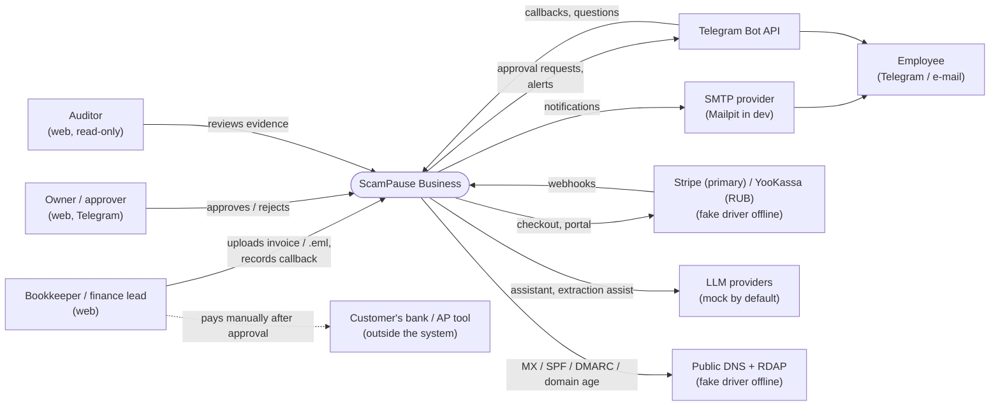
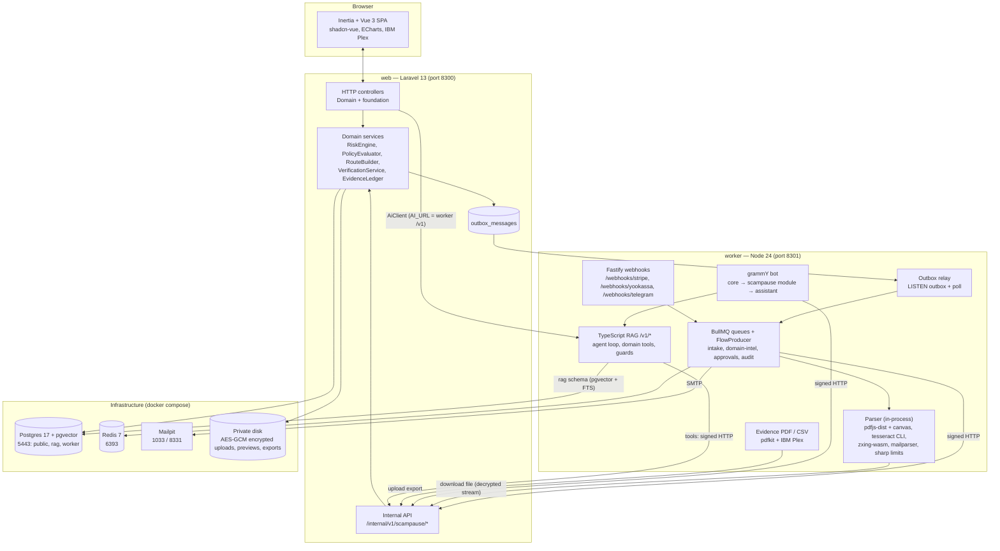
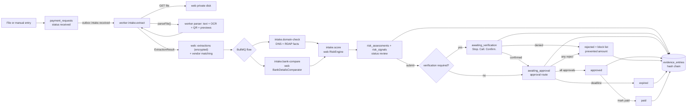
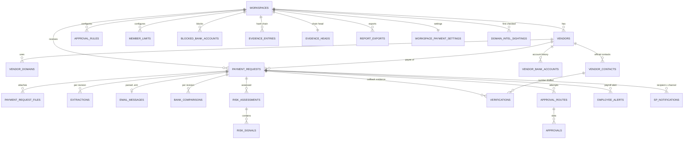
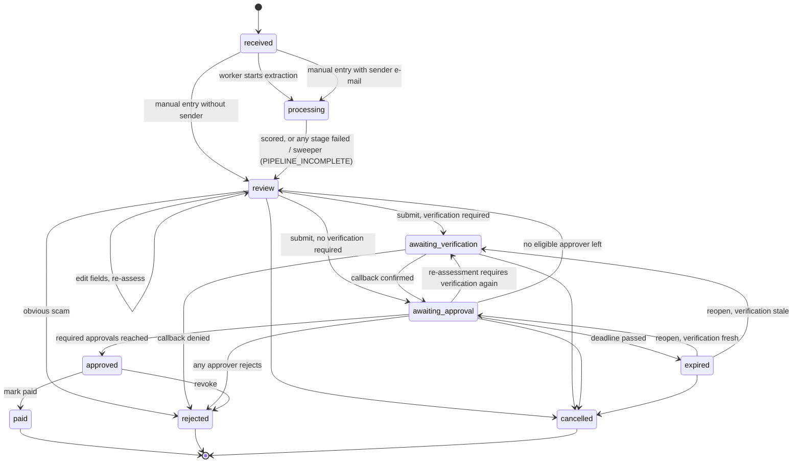
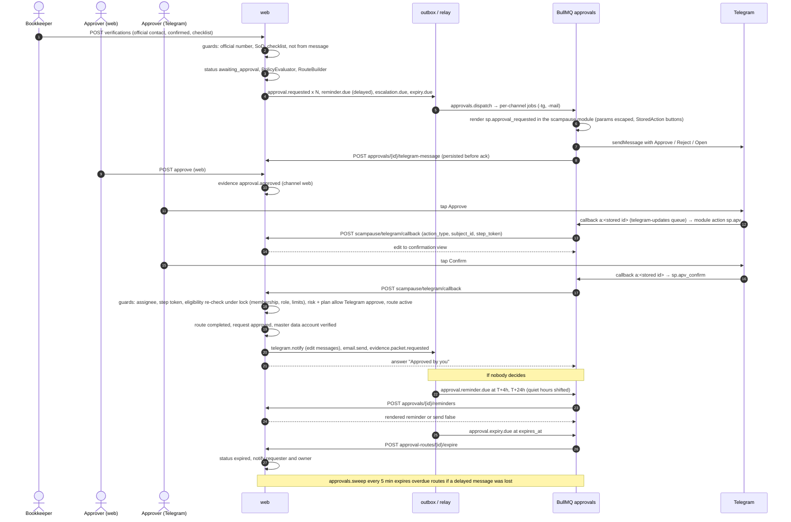
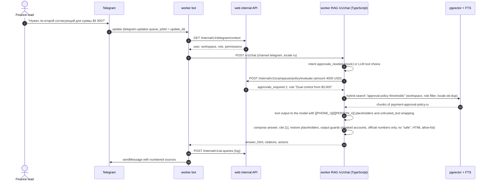
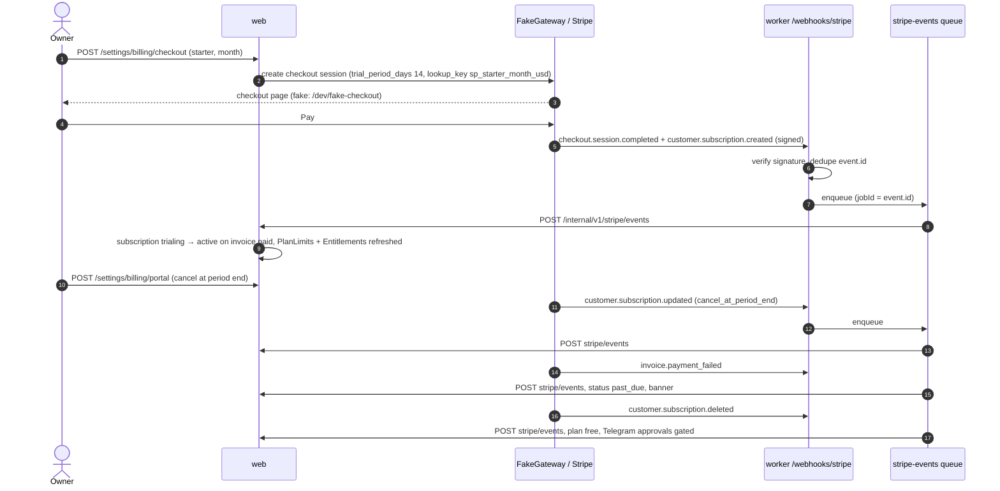
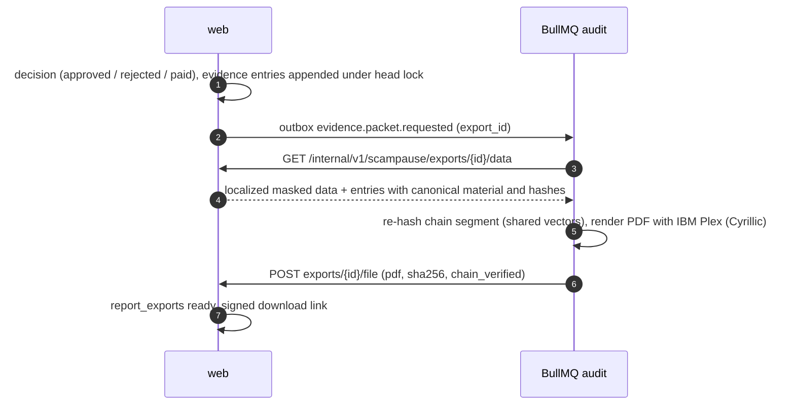

# ScamPause Business — Architecture

Shared services and contracts are defined in `PLATFORM.md`. **Strict stack for this product (PLATFORM §0.10):** web = Laravel + Vue (Inertia); worker = Node 24 + BullMQ/Redis + grammY, which also hosts OCR (`tesseract` CLI), PDF/EML extraction and the **TypeScript RAG** (`apps/worker/src/rag`, `/v1/*` contract of PLATFORM §4.4 on the worker port); e2e = Playwright. There is **no Python/FastAPI service** (ADR-0010).
This document shows how the ScamPause domain uses them. Precise names, payloads and rules: `docs/DOMAIN_CONTRACT.md`.

## 1. System context



ScamPause never moves money: the payment is executed by the customer in their own bank after the approval is recorded.

## 2. Containers



Ownership rule (PLATFORM §3): **web owns every business decision and all decrypted bank data**; worker does orchestration and external I/O
(parsing/OCR/QR, DNS/RDAP, Telegram, SMTP, PDF rendering) and the RAG (retrieval, LLM calls), which reaches domain data only through permission-checked tools on the internal API.

Foreign-to-the-foundation seams this product uses are listed exactly in DOMAIN_CONTRACT §11.5 (route requires, `config/permissions.php`, `WorkspaceRole`, `HandleInertiaRequests`, plan usage resolvers, deletion events, worker queue/handler/module/scheduler registration, RAG registry/intents/output-guard/post-fusion hooks).

## 3. Data flow — intake to decision



## 4. Data model overview



Intra-workspace foreign keys use `NO ACTION`; users referenced by evidence are pseudonymized, never hard-deleted; workspace purge runs through `WorkspacePurger` with the evidence GUC (ADR-0011).

## 5. Payment request state machine



## 6. Sequence — intake, extraction and risk assessment

```mermaid
sequenceDiagram
    autonumber
    actor U as Bookkeeper
    participant W as web
    participant DB as Postgres
    participant R as worker relay
    participant Q as BullMQ intake
    participant P as worker parser (in-process)
    participant DNS as DNS / RDAP
    U->>W: POST /payment-requests (invoice.pdf)
    W->>DB: insert payment_request (received), file, evidence request.created
    W->>DB: outbox intake.received (same transaction)
    W-->>U: redirect to case file (polls status)
    W->>R: NOTIFY outbox
    R->>DB: claim rows FOR UPDATE SKIP LOCKED
    R->>Q: add intake.extract (jobId = outbox id)
    Q->>W: POST pipeline extract running
    Q->>W: GET intake files + file stream
    Q->>P: parseFile(bytes, rus+eng, detect_qr, limits)
    P->>P: pdfjs text layer, tesseract CLI per page (30 s cap), zxing-wasm
    P-->>Q: pages text, ocr_used, missing_languages, qr_codes, previews
    Q->>W: POST previews (≤ 10 PNG pages, stored encrypted)
    Q->>Q: extractFields (amount, IBAN, dates, sender)
    Q->>W: POST extraction (ExtractionResult)
    W->>DB: store encrypted text + fields, vendor match
    W-->>Q: proceed, domains
    Q->>Q: flow parent intake.score, children domain-check + bank-compare
    par domain facts
        Q->>W: GET domain-intel (mode live / cache_only)
        Q->>DNS: MX, SPF, _dmarc, RDAP registration date
        Q->>W: POST domain-intel facts
    and bank comparison
        Q->>W: POST bank-comparison
        W->>DB: compare fingerprints with vendor history, store outcome
    end
    Q->>W: POST assess
    W->>DB: RiskEngine signals + score, status review, evidence request.assessed
    W->>DB: outbox telegram.notify (template + raw params) / email.send (if high or critical)
    Note over Q,W: any stage's final failure → POST pipeline failed → review with PIPELINE_INCOMPLETE, verification forced; pipeline:sweep republishes stuck requests
    U->>W: GET status (poll) shows review with signals
```

## 7. Sequence — verification, approvals in web and Telegram, reminders and expiry



## 8. Sequence — Telegram RAG question with domain tools



## 9. Sequence — Stripe subscription lifecycle (fake driver exercises the real webhook path; YooKassa for RUB uses the same `BillingGateway` with worker-scheduled renewals, PLATFORM §11.3)



## 10. Sequence — evidence packet



## 11. Cross-cutting decisions

| Concern | Decision |
|---|---|
| Tenancy | `workspace_id` on every domain row; global scope; internal API asserts workspace; only `domain_intel` (public facts) is global |
| Secrets & bank data | Laravel encrypted casts; keyed HMAC fingerprints for equality; masked everywhere by default; audited reveal (ADR-0002) |
| Idempotency | Outbox ids as BullMQ job ids; per-stage job ids include `revision`; web answers 409 `stale_revision` → worker no-op |
| Time | UTC instants, workspace timezone for business rules and reports, injected clock (ADR-0006) |
| Determinism | Rules engine pure functions with `rules_version` and `inputs_digest` (ADR-0001) |
| Observability | Request id propagated web → worker (jobs, bot, RAG); Prometheus metrics for pipeline stages, notifications, evidence checks |
| Stack | Laravel + Vue, Node/BullMQ (+ bot + TS RAG + OCR), Playwright; no Python (ADR-0010) |
| Privacy | Deletion = pseudonymize evidence-referenced users + ordered workspace purge; retention categories in the foundation purge job; data-subject redaction outside hash material (ADR-0011, DOMAIN_CONTRACT §12) |
| Callback numbers | Master data with four-eyes verification and cooldown (ADR-0012) |
| Untrusted text | E-mail subjects, vendor names, file names are escaped in Telegram/e-mail templates, wrapped as `untrusted_text` for the LLM, CSV-injection-neutralised in exports |
| Offline dev | Fake Stripe/YooKassa, fake Telegram transport + dev routes, mock LLM, fake DNS/RDAP (refused in production), hash embeddings |

## 12. ADR index

| ADR | Title | Status |
|---|---|---|
| [0001](adr/0001-rule-based-risk-engine.md) | Deterministic rule-based risk engine in web; LLM only as helper | Accepted |
| [0002](adr/0002-bank-data-encryption-and-fingerprints.md) | Bank data: application-level encryption, keyed fingerprints, decrypted data stays in web | Accepted |
| [0003](adr/0003-extraction-pipeline-bullmq-flow.md) | Extraction pipeline as a BullMQ flow in the worker; parsing, OCR and QR in-process | Accepted (revised 2026.10.2) |
| [0004](adr/0004-hash-chained-evidence-ledger.md) | Hash-chained evidence ledger next to the audit log | Accepted |
| [0005](adr/0005-telegram-approvals-asymmetric.md) | Telegram approvals: two-step confirm, risk-gated approve, reject always allowed | Accepted |
| [0006](adr/0006-deadlines-delayed-outbox-and-sweeper.md) | Approval deadlines and reminders via delayed outbox messages plus a sweeper | Accepted |
| [0007](adr/0007-multi-currency-base-amounts.md) | Multi-currency: rules on base-currency amounts, manual FX, missing rate = strictest | Accepted |
| [0008](adr/0008-bookkeeping-firms-multi-workspace.md) | Bookkeeping firms as members of client workspaces in MVP; Practice entity in v1 | Accepted |
| [0009](adr/0009-no-payment-blocking-risk-language.md) | No payment initiation/blocking; "risk, not safety" language policy | Accepted |
| [0010](adr/0010-node-only-stack-typescript-rag.md) | Strict stack: no Python service; OCR, extraction and RAG in the Node worker | Accepted |
| [0011](adr/0011-deletion-pseudonymization-retention.md) | Deletion by pseudonymization, ordered workspace purge, retention with ledger checkpoints | Accepted |
| [0012](adr/0012-callback-contacts-four-eyes.md) | Callback contacts as four-eyes master data with cooldown | Accepted |
